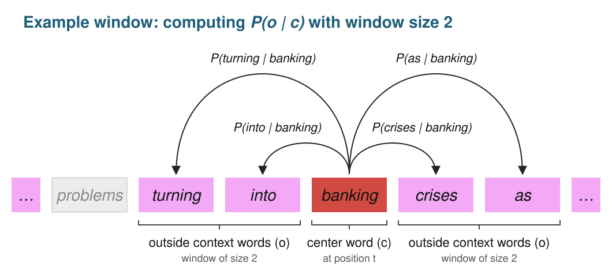

# CS224N Lecture 1：词向量与 Word2vec

## 第一步：问题是什么

计算机怎么表示"词的意思"？

- WordNet 靠人工维护的词典，跟不上新词。
- one-hot 里每个词都是独立的，hotel 和 motel 看不出相似。

## 第二步：思路（分布语义学 Distributional Semantics）

一个词的意思，由它周围经常出现的词决定。所以我们不去"定义"词义，而是让每个词对应一个向量，并要求：上下文相似的词，向量也相似。

## 第三步：模型长什么样（Word2vec）

拿一句话举例：`problems turning into banking crises as`

- 中心词 c = banking，窗口（大小为 2）内的上下文词 o = turning、into、crises、as。
- 模型要回答："看到 banking，旁边出现 crises 的概率是多少？"
- 每个词有两个向量：作中心词时用 $v$，作上下文词时用 $u$。所以用 $v_{banking}$ 和 $u_{crises}$ 做点积，再用 softmax 变成概率：

$$P(o\mid c)=\frac{\exp(u_o^\top v_c)}{\sum_{w\in V}\exp(u_w^\top v_c)}$$

公式分三步理解：

1. **点积**：$u_o^\top v_c=\sum_{i=1}^{n}(u_o)_i(v_c)_i$，越大说明 o 和 c 越相似。
2. **exp**：把点积变成正数（概率不能为负）。
3. **归一化**：分母对整个词表求和，让所有词的概率加起来等于 1。

这个形式就是 **softmax 函数**，它把任意实数变成概率分布：

$$\text{softmax}(x_i)=\frac{\exp(x_i)}{\sum_{j=1}^{n}\exp(x_j)}=p_i$$

- **"max"**：放大最大的 $x_i$ 的概率。
- **"soft"**：较小的 $x_i$ 仍然分到一点概率，不会被压成 0。

## 第四步：怎么衡量"好不好"

语料里每个位置都有真实的（中心词，上下文词）对，比如（banking, crises）、（banking, into），每一对都能算出一个概率。

- 把它们连乘，得到似然函数 $L(\theta)$：

$$L(\theta)=\prod_{t=1}^{T}\ \prod_{\substack{-m\le j\le m\\ j\ne 0}} P(w_{t+j}\mid w_t;\theta)$$

- 取负对数再平均，得到损失 $J(\theta)$（也叫目标函数）：

$$J(\theta)=-\frac{1}{T}\log L(\theta)=-\frac{1}{T}\sum_{t=1}^{T}\ \sum_{\substack{-m\le j\le m\\ j\ne 0}} \log P(w_{t+j}\mid w_t;\theta)$$

符号说明：$\theta$ 是所有要优化的参数（每个词的 $v_w$ 和 $u_w$）；$T$ 是语料长度；$m$ 是窗口大小；$j\ne 0$ 表示不包括中心词自己。

$J$ 越小，说明模型对真实语料越不"意外"，预测越准。**最小化 $J(\theta)$ ⟺ 最大化预测准确率。**

## 第五步：怎么优化（梯度下降）

重复下面这个循环：

1. 用当前向量算 $J$。
2. 对 $J$ 求梯度，得到"往哪调向量能让 $J$ 变小"。
3. 沿负梯度方向把所有向量调一点点：$\theta \leftarrow \theta-\alpha\nabla_\theta J$（$\alpha$ 是学习率）。
4. 回到第 1 步。

语料太大，每次不可能扫完全部，所以每次只抽一小批窗口来算梯度，这就是 SGD。

梯度的含义也很直观：

$$\frac{\partial}{\partial v_c}\log P(o\mid c)=u_o-\sum_{x\in V} P(x\mid c)\,u_x$$

即 **真实出现的上下文向量 − 模型当前预期的上下文向量**。每一步，$v_c$ 都被往"真实"那边拉一点，从"预期"那边推开一点。

## 第六步：最后得到什么

练完之后，hotel 和 motel 因为总出现在相似的上下文里，向量自然就靠近了。这些向量就是词向量，可以拿去做下游任务。