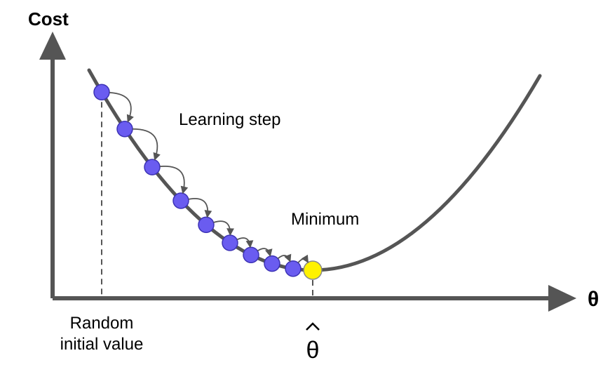
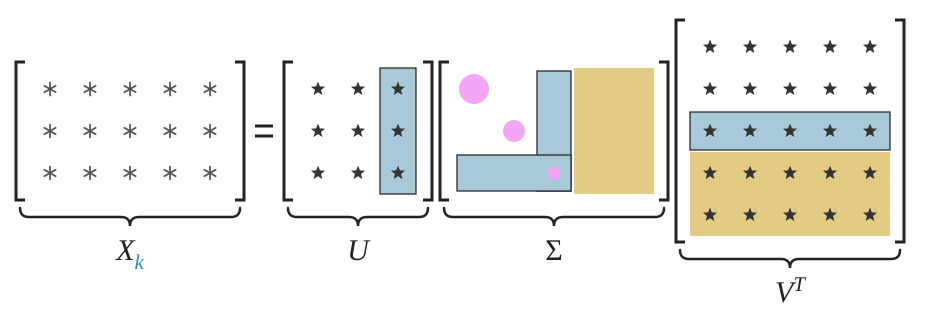

# CS224N Lecture 2：词向量、词义与神经分类器

## 1. 优化：从梯度下降到 SGD

**梯度下降**：在当前的 $\theta$ 处计算损失 $J(\theta)$ 的梯度，沿负梯度方向走一小步来最小化 $J(\theta)$，重复直到收敛。

$$\theta^{\text{new}}=\theta^{\text{old}}-\alpha\nabla_{\theta}J(\theta)$$

其中 $\alpha$ 是学习率（步长）。

**问题**：$J(\theta)$ 是语料中所有窗口，算一次完整梯度代价太高，对神经网络来说几乎不可行。

**解决：随机梯度下降（SGD, Stochastic Gradient Descent）**。每次只抽一小批，即 mini-batch 算完就更新；并且抽样带来的噪声还有助于跳出局部最优。

---

## 2. word2vec 回顾

**word2vec 的两种模型变体：**

1. **Skip-gram（SG）**：给定中心词，预测上下文（"外部"）词。
2. **连续词袋（CBOW, Continuous Bag of Words）**：根据一"袋"上下文词，预测中心词。

本讲讲的是 Skip-gram 模型。

**回顾**：随机初始化词向量，遍历语料中每个位置，用中心词的向量预测周围的词，再更新向量。每个词有两个向量：作中心词时用 $v$，作上下文词时用 $u$。

**问题：softmax 太贵。** 把 naive softmax 的损失展开：

$$-\log P(o\mid c)=-u_o^\top v_c+\log\sum_{w\in V}\exp(u_w^\top v_c)$$

第一项把真实上下文词 $u_o$ 拉向 $v_c$，第二项（分母）把词表里所有词都推离 $v_c$。对 $v_c$ 求梯度得到：

$$\nabla_{v_c}=-u_o+\sum_{w\in V}P(w\mid c)\,u_w$$

即"真实的上下文向量"减去"模型当前期望的上下文向量"。贵的就是后一项对整个词表的求和。

**解决：负采样。** 把"在词表中选对一个词"的多分类，改成"真实词对 vs 噪声词对"的二分类：

$$J_{\text{neg-sample}}=-\log\sigma(u_{o}^{\top}v_{c})-\sum_{k\in\{K\text{ sampled indices}\}}\log\sigma(-u_{k}^{\top}v_{c})$$

第一项让真实上下文词 $o$ 与中心词 $c$ 的点积变大；第二项让 $K$ 个随机抽到的噪声词的点积变小，用 $K$ 个样本代替对整个词表的求和。

- **为什么需要负例**：只保留第一项的话，最省事的办法是让所有向量指向同一方向、点积尽量大，损失趋于 0 却什么都没学到。
- **为什么按 $U(w)^{3/4}$ 抽样**：均匀抽样抽到的几乎全是生僻词，太容易区分；完全按词频抽，又几乎全是 the、of 这类高频词。$3/4$ 次方是折中，让低频词也可以被多抽到一些。

---

## 3. 为什么不直接统计共现？

word2vec 要反复扫描整个语料，那为什么不直接统计哪些词经常一起出现？这就是**共现矩阵** $X$ 的思路：

- **共现矩阵** $X$：窗口式能抓住句法和语义；词-文档式能抓住主题（即 LSA）。
- 但直接把每一行当词向量不行：维度等于词表大小，又高又稀疏，下游模型不稳健。
- **SVD 降维**：$X=U\Sigma V^{\top}$，只保留最大的 $k$ 个奇异值，得到的 $\hat{X}$ 是最小二乘意义下的最佳秩 $k$ 近似。但大矩阵上计算很贵。
- **并且直接对原始计数做 SVD 效果不好**：the、he 这类功能词太高频，句法信息压过了语义。需要先缩放计数，例如取 log、给计数设上限 $\min(X,t)$、忽略功能词。（都是在 SVD 之前改 $X$）

---

## 4. GloVe

这一节要解决的问题：SVD 路线要靠一堆缩放技巧，word2vec 只看局部窗口。能不能直接拟合全局共现统计，同时让词义成分变成向量空间里的线性方向？

**三条路线对比：**

| 方法 | 思路 | 特点 |
|---|---|---|
| SVD | 先统计全局共现，再矩阵分解 | 大矩阵上计算贵，需要缩放技巧 |
| word2vec | 边扫语料边用 SGD 预测上下文词 | 每次只看局部窗口 |
| GloVe | 在全局共现统计上，用梯度下降训练向量 | 兼顾两者，训练快、可扩展 |

---

## 5. 怎么评价词向量

| | 内在评价（intrinsic） | 外在评价（extrinsic） |
|---|---|---|
| 做法 | 在某个子任务上测 | 放进真实任务里测 |
| 优点 | 快，有助于理解系统 | 可信 |
| 缺点 | 不一定与真实任务相关 | 慢，出问题时难以定位原因 |

---

## 6. 一词多义

常见词往往有很多个意思（如 pike）。**但一个向量装得下吗？** 有两种解决思路：

**思路一：每个词义放一个向量。** 对一个词的上下文窗口聚类，每个簇单独学一个向量，如 bank₁、bank₂ ……

**思路二：一个词只用一个向量，各词义在其中线性叠加。** 在 word2vec 这样的标准词向量里，一个词的向量是各词义向量的加权和，权重由各词义的出现频率决定：

$$v_{\text{pike}}=\alpha_{1}v_{\text{pike}_{1}}+\alpha_{2}v_{\text{pike}_{2}}+\alpha_{3}v_{\text{pike}_{3}},\qquad \alpha_{1}=\frac{f_{1}}{f_{1}+f_{2}+f_{3}}$$

借助稀疏编码，还能把叠加在一起的词义重新分离出来（如 tie 被分成衣物、比赛平局、电线、歌唱声部几类）。

---

## 7. 神经分类器

### 7.1 窗口分类做 NER

**NER**：给每个词打标签。同一个词在不同语境下标签不同：Paris Hilton 里的 Paris 是人名，Hilton Hotel in Paris 里的 Paris 是地点。

### 7.2 softmax 分类器 vs 神经网络分类器

| | 传统 softmax 分类器 | 神经网络分类器 |
|---|---|---|
| 学什么 | 只学权重 $W$ | 同时学 $W$ 和词的分布式表示 |
| 决策边界 | 线性 | 有多层，可以是非线性 |

神经网络里，词向量把 one-hot 向量重新表示到一个中间向量空间，使得最后的线性 softmax 就能分得开；多层网络则可以反复地重新表示、组合数据。所以整个分类器对原始输入是非线性的，但相对最后一个隐藏层的表示，通常仍是线性的。