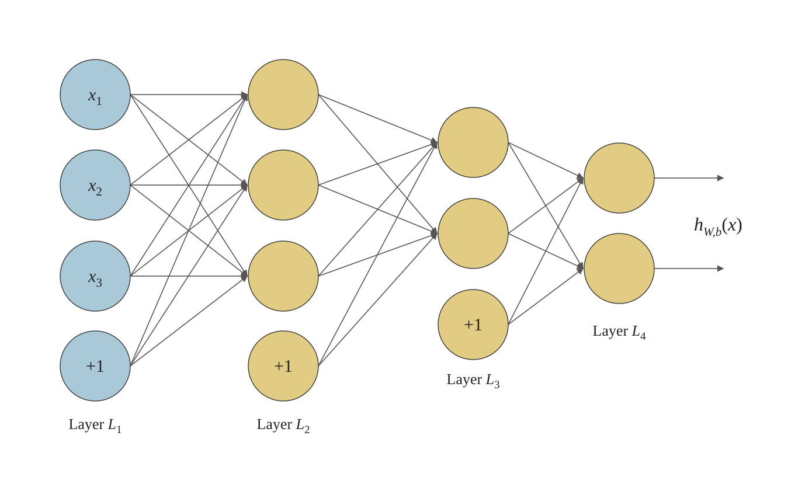
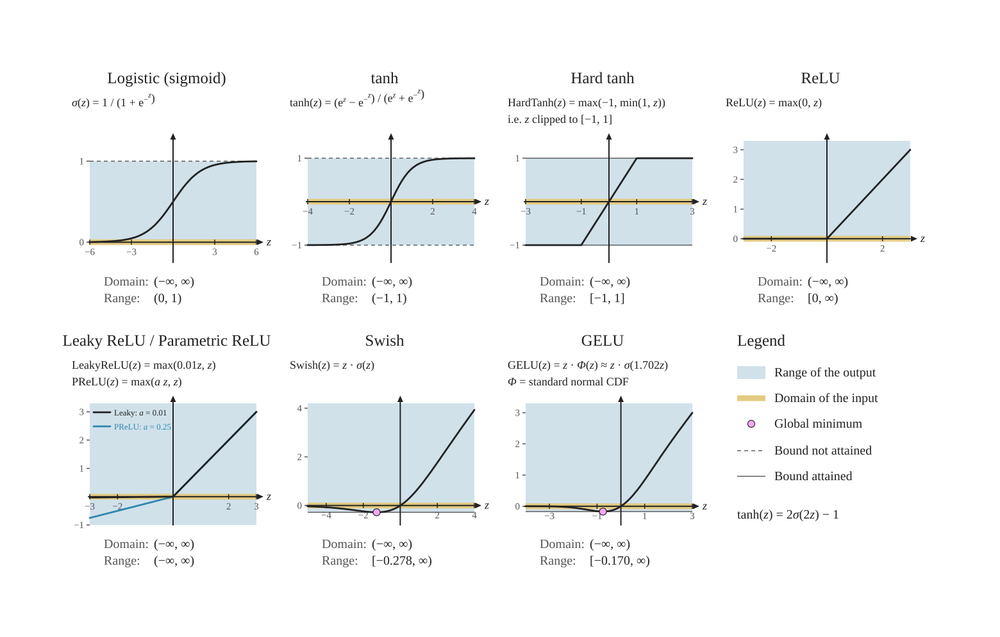

# CS224N Lecture 3 笔记：神经网络、激活函数、矩阵求导与反向传播

**先有模型：多层神经网络，靠非线性激活函数获得表达力 → 训练需要梯度 → 梯度用 Jacobian 和链式法则手算 → "复用"和反向传播 。**

整节课围绕一个问题：**怎么高效地算出 $\nabla_\theta J(\theta)$来进行下一步训练？** 

---

## 第 1 步：神经网络是什么？

### 1.1 从逻辑回归到神经网络

**一个神经网络 = 同时跑好几个逻辑回归**。

  

- 一个神经元做的事：对输入加权求和再加偏置，然后过一个非线性函数。
- 把很多神经元并排放成一层，再把一层的输出作为下一层的输入，**就得到了多层神经网络**。
- 好处是：可以对数据**多次重新表示（re-represent）和组合（compose）**。相对于原始输入，最终分类器是**高度非线性**的；但相对于倒数第二层的表示，它通常只是**线性**的（最后一层就是一个逻辑回归/线性打分）。

### 1.2 一层神经元的矩阵写法

单个神经元：$a_1=f(W_{11}x_1+W_{12}x_2+W_{13}x_3+b_1)$，其余类推。写成矩阵：

$$z=Wx+b,\qquad a=f(z)$$

其中激活函数 $f$ **逐元素**作用：$f([z_1,z_2,z_3])=[f(z_1),f(z_2),f(z_3)]$。

- $W_{ij}$ 是第 $j$ 个输入连到第 $i$ 个神经元的权重，$b_i$ 是该神经元的偏置。

### 1.3 贯穿全课的模型：NER 窗口分类

判断 "museums in **Paris** are amazing" 的中心词是不是地名：

$$x\in\mathbb{R}^{5d}\ \xrightarrow{\,W,b\,}\ z=Wx+b\ \xrightarrow{\,f\,}\ h=f(z)\ \xrightarrow{\,u\,}\ s=u^\top h\ \xrightarrow{\,\sigma\,}\ P(\text{是地名})$$

- $x$：窗口内 5 个词的词向量拼接
- $W\in\mathbb{R}^{n\times 5d},\ b\in\mathbb{R}^n$：第一层参数；$h\in\mathbb{R}^n$：隐藏层
- $u\in\mathbb{R}^n$：输出层权重，把 $h$ 压成标量分数 $s$（相当于最后一个逻辑回归）
- 课件为简单起见只对分数 $s$ 求梯度；词向量本身也是被训练的参数

---

## 第 2 步：激活函数是什么？

### 2.1 起点：阈值单元为什么不行

最早的 McCulloch & Pitts（1943）阈值单元：

$$\mathbf{1}(Wx>\theta)=\mathbf{1}(Wx-\theta>0)$$

它是一个阶跃函数：**除了跳变点，处处斜率为 0**，因此**无法做基于梯度的学习** （no gradient-based learning）。这就引出了激活函数的第一个要求：**必须可微（有斜率）**。

### 2.2 为什么必须有非线性？

- 神经网络做的是函数逼近（回归或分类）。
- **没有非线性**，再深的网络也只是一个线性变换：额外的层可以被"编译"成一个，$W_1W_2x=Wx$。
- **有了非线性**，多层网络就能逼近任意复杂的函数（决策边界可以是弯曲的，而不只是一条直线）。

### 2.3 相关激活函数

| # | 名称 | 公式 | 值域 | 课件中的要点 |
|---|---|---|---|---|
| 1 | **logistic（sigmoid）** | $f(z)=\dfrac{1}{1+e^{-z}}$ | (0, 1) | 仍在使用，典型用途是**输出概率** |
| 2 | **tanh** | $\tanh(z)=\dfrac{e^z-e^{-z}}{e^z+e^{-z}}$ | (−1, 1) | 就是**缩放平移后的 sigmoid**：$\tanh(z)=2\,\text{logistic}(2z)-1$（2 倍陡，值域 [−1,1]）；也仍在使用 |
| 3 | **hard tanh** | $-1\ (x<-1)$；$x\ (-1\le x\le1)$；$1\ (x>1)$ | [−1, 1] | tanh 的**分段线性**版本，计算便宜 |
| 4 | **ReLU**（Rectified Linear Unit） | $\max(z,0)$ | [0, ∞) | **深层网络首先要试的**：训练快、效果好，因为**梯度回传好**；缺点是负半轴有"**死区（dead zone）**" |
| 5 | **Leaky ReLU** | 负半轴斜率固定，如 $y=0.01x$ | (−∞, ∞) | 缓解 ReLU 的死区 |
| 6 | **Parametric ReLU（PReLU）** | 负半轴斜率 $a$ 是**可学习参数**，$y=ax$ | (−∞, ∞) | 同上，把斜率交给训练来定 |
| 7 | **Swish** | $\text{swish}(x)=x\cdot\text{logistic}(x)$ | ≈ [−0.28, ∞) | 光滑，常用于 Transformer |
| 8 | **GELU** | $x\cdot P(X\le x),\ X\sim N(0,1)\ \approx\ x\cdot\text{logistic}(1.702x)$ | ≈ [−0.17, ∞) | 光滑，**BERT、RoBERTa 等 Transformer 常用** |

  

---

## 第 3 步：为什么需要梯度？（SGD）

有了模型，就要训练。SGD 的更新公式是 $\theta^{new}=\theta^{old}-\alpha\nabla_\theta J(\theta)$，即对每个参数：$\theta_j^{new}=\theta_j^{old}-\alpha\,\partial J/\partial\theta_j$。

所以lecture3的任务是：**对第 1 步模型里的每个参数（$W,b,u$，以及词向量）求偏导**。课件给出两条路：**手算**（理解数学）和**算法**（反向传播，让机器算）。后者是前者的系统化。

---

## 第 4 步：手算：Jacobian 与链式法则

- 梯度（n 输入 1 输出）是 $1\times n$ 行向量；Jacobian（n 输入 m 输出）是 $m\times n$ 矩阵，$(\partial f/\partial x)_{ij}=\partial f_i/\partial x_j$
- 链式法则：一元是导数相乘，多元是 **Jacobian 相乘**

对 $s=u^\top f(Wx+b)$ 求 $\partial s/\partial b$，就是把网络拆成小块，**每块各求一个 Jacobian，再按顺序乘起来**：

$$\frac{\partial s}{\partial b}=\frac{\partial s}{\partial h}\frac{\partial h}{\partial z}\frac{\partial z}{\partial b}$$

这就是课件的三步法：**① 拆成简单步骤（并标清每个变量的维度）② 套链式法则 ③ 写出每个 Jacobian**。

需要的"零件"Jacobian：

#### 零件 1：$z=Wx+b$ 对 $x$ 求导

$$\frac{\partial}{\partial x}(Wx+b)=W$$

逐分量写出 $z_i$：

$$z_i=\sum_{k}W_{ik}x_k+b_i$$

对 $x_j$ 求偏导，只有 $k=j$ 那一项含 $x_j$，所以：

$$\frac{\partial z_i}{\partial x_j}=W_{ij}$$

第 $(i,j)$ 个元素正好是 $W_{ij}$，拼起来就是矩阵 $W$。

#### 零件 2：$z=Wx+b$ 对 $b$ 求导

$$\frac{\partial}{\partial b}(Wx+b)=I$$

逐分量写出 $z_i$：

$$z_i=\sum_{k}W_{ik}x_k+b_i$$

其中 $\sum_k W_{ik}x_k$ 不含 $b$，对 $b$ 来说是常数。第 $(i,j)$ 个元素 $\dfrac{\partial z_i}{\partial b_j}$ 分两种情况：

- $i=j$ 时：$\dfrac{\partial z_i}{\partial b_i}=0+1=1$
- $i\neq j$ 时：$z_i$ 里只含 $b_i$，不含 $b_j$，所以 $\dfrac{\partial z_i}{\partial b_j}=0$

对角线为 1、其余为 0，结果就是单位矩阵：

$$
\frac{\partial z}{\partial b}
=\begin{pmatrix}
1 & 0 & \cdots & 0\\
0 & 1 & \cdots & 0\\
\vdots & \vdots & \ddots & \vdots\\
0 & 0 & \cdots & 1
\end{pmatrix}
=I
$$

#### 零件 3：内积 $s=u^\top h$ 分别对 $u$ 和 $h$ 求导

先把内积展开：

$$s=u^\top h=\sum_{k=1}^{n}u_kh_k=u_1h_1+u_2h_2+\cdots+u_nh_n$$

对 $u$ 求导：只有 $u_jh_j$ 这一项含 $u_j$，所以 $\dfrac{\partial s}{\partial u_j}=h_j$，拼成行向量：

$$\frac{\partial}{\partial u}(u^\top h)=h^\top$$

对 $h$ 求导：只有 $u_jh_j$ 这一项含 $h_j$，所以 $\dfrac{\partial s}{\partial h_j}=u_j$，拼成行向量：

$$\frac{\partial}{\partial h}(u^\top h)=u^\top$$

#### 零件 4：逐元素激活 $h=f(z)$ 对 $z$ 求导

$$\frac{\partial h}{\partial z}=\mathrm{diag}\big(f'(z)\big)$$

因为 $f$ 是逐元素的，$h_i=f(z_i)$ 只依赖 $z_i$，所以 Jacobian 是对角矩阵：**只有对角线上非零，其余全是 0**。完整写出来是：

$$
\frac{\partial h}{\partial z}
=\begin{pmatrix}
\dfrac{\partial h_1}{\partial z_1} & \dfrac{\partial h_1}{\partial z_2} & \cdots & \dfrac{\partial h_1}{\partial z_n}\\[2ex]
\dfrac{\partial h_2}{\partial z_1} & \dfrac{\partial h_2}{\partial z_2} & \cdots & \dfrac{\partial h_2}{\partial z_n}\\[2ex]
\vdots & \vdots & \ddots & \vdots\\[1ex]
\dfrac{\partial h_n}{\partial z_1} & \dfrac{\partial h_n}{\partial z_2} & \cdots & \dfrac{\partial h_n}{\partial z_n}
\end{pmatrix}
=\begin{pmatrix}
f'(z_1) & 0 & \cdots & 0\\
0 & f'(z_2) & \cdots & 0\\
\vdots & \vdots & \ddots & \vdots\\
0 & 0 & \cdots & f'(z_n)
\end{pmatrix}
=\mathrm{diag}\big(f'(z)\big)
$$

两种位置的元素分别是：

- 对角元素（$i=j$）：普通的一元导数，$\dfrac{\partial h_i}{\partial z_i}=f'(z_i)$
- 非对角元素（$i\neq j$）：$h_i=f(z_i)$ 不含 $z_j$，所以 $\dfrac{\partial h_i}{\partial z_j}=0$

$\mathrm{diag}(v)$ 的意思是：把向量 $v$ 放到对角线上，其余位置补 0 得到的矩阵。这里 $f'(z)=[f'(z_1),\dots,f'(z_n)]$ 是对 $z$ 逐元素求导得到的向量。

#### 四个零件放回推导链

$$\frac{\partial s}{\partial b}
=\underbrace{\frac{\partial s}{\partial h}}_{u^\top\ (\text{零件 }3)}\
\underbrace{\frac{\partial h}{\partial z}}_{\mathrm{diag}(f'(z))\ (\text{零件 }4)}\
\underbrace{\frac{\partial z}{\partial b}}_{I\ (\text{零件 }2)}$$

---

## 第 5 步：把零件拼起来，发现"可以复用"

**先算 $b$ 的梯度。** 把零件 3、4、2 代入推导链：

$$\frac{\partial s}{\partial b}=u^\top\,\mathrm{diag}\big(f'(z)\big)\,I = u^\top\circ f'(z)$$

（对角矩阵乘行向量，等价于 Hadamard 积 $\circ$，即逐元素相乘。）

**再算 $W$ 的梯度。** 链式法则写出来是：

$$\frac{\partial s}{\partial W}=\frac{\partial s}{\partial h}\,\frac{\partial h}{\partial z}\,\frac{\partial z}{\partial W}$$

**前两项和刚才完全一样！** 把它们合并，定义：

$$\delta=\frac{\partial s}{\partial h}\,\frac{\partial h}{\partial z}=u^\top\circ f'(z)$$

$\delta$ 叫**上游梯度（误差信号）**，是 $1\times n$ 的行向量。用它改写 $b$ 的结果，并补完 $W$ 的最后一项：

- $b$：$\dfrac{\partial s}{\partial b}=\delta\,\dfrac{\partial z}{\partial b}=\delta$
- $W$：$\dfrac{\partial z}{\partial W}$ 是三阶张量，不能直接当矩阵乘，所以逐分量推。$W_{ij}$ 只出现在 $z_i$ 里，系数是 $x_j$，因此 $\dfrac{\partial s}{\partial W_{ij}}=\delta_i\,x_j$

**转成形状约定**（梯度的形状 = 参数的形状）：

$$\frac{\partial s}{\partial b}=\delta^\top\ (n\times1),\qquad \frac{\partial s}{\partial W}=\delta^\top x^\top\ (n\times m)$$

其中 $\delta^\top x^\top$ 是外积：$[n\times1][1\times m]=[n\times m]$。

**最关键：** 先算一次 $\delta$，再让 $W$、$b$ 各自只乘上自己的"局部"部分（$W$ 乘 $x^\top$，$b$ 乘 $I$）。反向传播就是把这个"复用"思想推广到任意深度的计算图：每个节点只算一次"下游梯度 = 上游梯度 × 局部梯度"，整张图只反向遍历一遍，就得到所有参数的梯度。

### 形状约定（shape convention）

- **形状约定：梯度的形状 = 参数的形状。** 所以 $\partial s/\partial W$ 是 $n\times m$，$\partial s/\partial b$ 是列向量。
- 做法：**先用 Jacobian 形式推导（链式法则顺手），最后再转置/调整成参数的形状**。

---

## 第 6 步：从手算到算法

手算对两层网络还行，但网络变深后不可能每次手推。解决办法是把 $s=u^\top f(Wx+b)$ **画成计算图**：源节点是输入，内部节点是运算，边传递结果。

- **前向传播（fprop）**：按拓扑序计算每个节点的值，**并保存中间值**。
- **反向传播（bprop）**：输出梯度初始化为 1，按逆序遍历，每个节点做同一件事：

$$\boxed{\text{下游梯度}=\text{上游梯度}\times\text{局部梯度}}$$

这正是第 5 步 $\delta$ 复用思想的通用版：上游梯度 = 已经算好的 $\delta$，局部梯度 = 该节点输出对输入的 Jacobian（比如激活函数节点的局部梯度就是 $\mathrm{diag}(f'(z))$）。

**两种特殊情况：**

1. **多输入节点**（如 $z=Wx$）：每个输入有自己的局部梯度，各自乘上游梯度，得到各自的下游梯度。
2. **一个变量被多处使用**（分支）：**梯度相加**。这就是多元链式法则 $\frac{\partial z}{\partial x}=\sum_i\frac{\partial z}{\partial y_i}\frac{\partial y_i}{\partial x}$。

### 为什么要"一次算完所有梯度"？

如果先单独算 $\partial s/\partial b$、再单独算 $\partial s/\partial W$，中间那一大段会被重复计算。反向传播只走一遍就得到所有参数的梯度，**bprop 的复杂度与 fprop 同阶**。这就是"高效"的来源。

---

## 第 7 步：落地与意义

- 节点直觉：**+ 分发**上游梯度，**max 路由**给较大者，**\* 交换**（乘对方的值）
- 例：$f=(x+y)\max(y,z)$，$x=1,y=2,z=0$，则 $\partial f/\partial y=3+2=5$（$y$ 有两条出路，梯度相加）
- 实现：每个节点实现 forward（保存输入）和 backward（上游 × 局部）；框架自动微分，但局部导数仍要有人写
- 数值梯度检查 $\frac{f(x+h)-f(x-h)}{2h}$：很慢，只用来验证自己写的层
- 意义：梯度是 $f'(z)$ 的连乘。logistic 的导数最大只有 0.25，容易让梯度消失；ReLU 正区间导数为 1，所以回传好（之后会讲梯度消失/爆炸）

